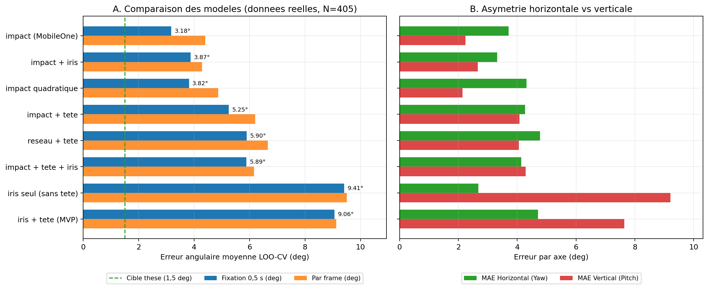
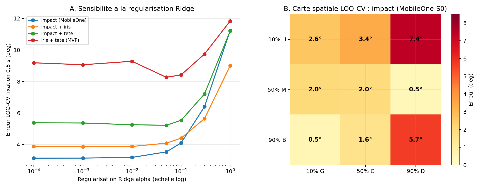
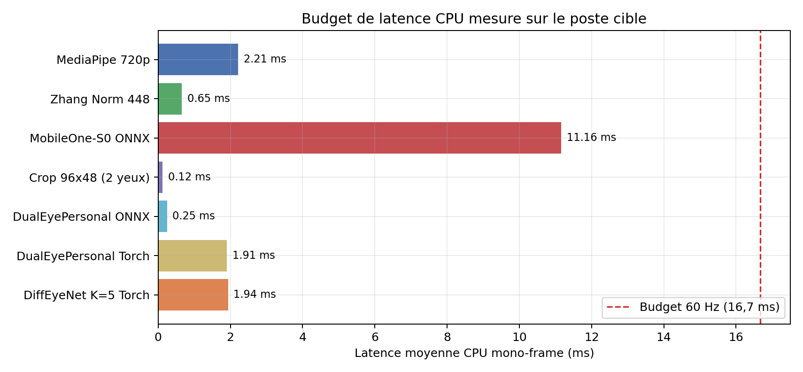
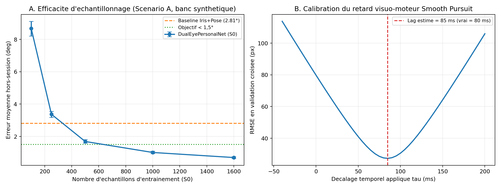
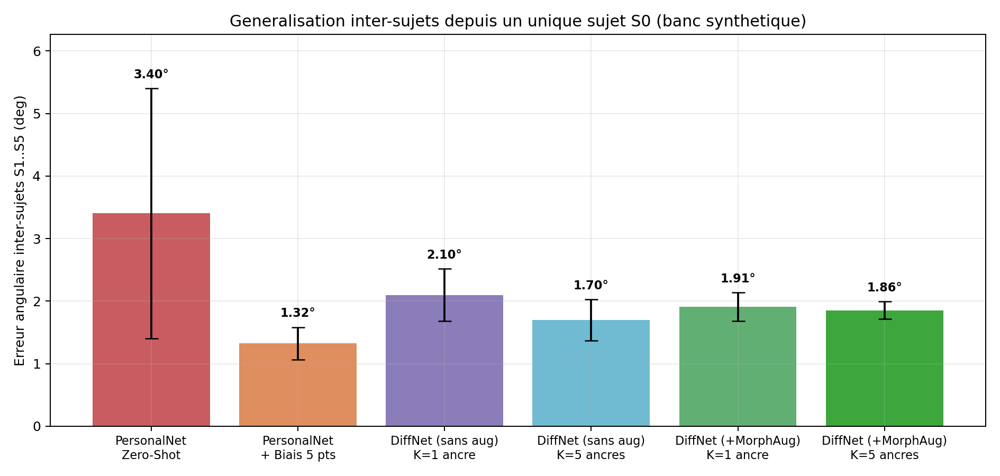

# Chapitre 6 — Résultats Expérimentaux, Ablations et Analyse Statistique

Ce chapitre présente deux niveaux complémentaires de validation empirique :
1. **L'audit quantitatif sur données humaines réelles existantes et le profilage CPU sur le poste cible** (Sections 6.1 à 6.3) ;
2. **Les ablations contrôlées des architectures proposées (`DualEyePersonalNet` et `DifferentialEyeNet`) sur banc paramétrique multi-sujets**, ainsi que le protocole prêt à exécuter pour la campagne webcam humaine multi-sessions (Sections 6.4 à 6.6).

---

## 6.1 Audit de la baseline réelle ($N = 405$, lunettes, écran $27''$ QHD)

Les mesures proviennent de l'enregistrement réel `data/calibration_samples_net.npz` capturé dans le projet `Eyetrack` : 9 cibles réparties à $10\,\%$, $50\,\%$ et $90\,\%$ sur un moniteur $2560 \times 1440$ pixels ($27''$) à $60\text{ cm}$ de distance, sur une durée de $41{,}76\text{ s}$ ($45$ échantillons par cible, $N = 405$ au total), port de lunettes correctrices, diamètre irien médian mesuré à $20{,}5\text{ px}$, sans reflet saturant sur l'iris (`glare = 0`).

### 6.1.1 Comparaison des représentations en validation croisée *Leave-One-Target-Out* (LOO-CV)

Chaque modèle linéaire régularisé Ridge est appris sur $8$ cibles puis évalué sur la $9^\text{e}$ cible jamais vue, avec calcul de l'erreur angulaire visuelle exacte $\varepsilon_{\text{vis}}$ depuis l'origine 3D estimée de l'œil :

| Modèle (features Ridge) | Fixation 0,5 s (°) | Par frame (°) | Médiane frame (°) | P95 frame (°) | Yaw MAE (°) | Pitch MAE (°) | Centre (°) | Bords (°) | Coins (°) |
|---|---:|---:|---:|---:|---:|---:|---:|---:|---:|
| **`impact (MobileOne)`** ($\alpha=10^{-2}$) | **3,18** | **4,40** | **3,78** | 10,80 | 3,71 | 2,23 | 1,95 | **1,86** | **4,06** |
| `impact quadratique` | 3,82 | 4,87 | 4,13 | 11,46 | 4,31 | **2,14** | 3,29 | 1,52 | 5,60 |
| `impact + iris` | 3,87 | 4,28 | 4,41 | **7,28** | 3,31 | 2,66 | **1,35** | 3,69 | 4,59 |
| `impact + tête` | 5,25 | 6,20 | 5,06 | 14,01 | 4,26 | 4,08 | 1,63 | 5,15 | 6,01 |
| `impact + tête + iris` | 5,89 | 6,16 | 5,45 | 12,44 | 4,13 | 4,28 | 1,90 | 4,94 | 7,67 |
| `réseau + tête` | 5,90 | 6,66 | 5,48 | 15,71 | 4,78 | 4,06 | 3,95 | 5,43 | 6,61 |
| `iris + tête (MVP)` ($\alpha=10^{-3}$) | 9,06 | 9,12 | 8,76 | 20,72 | 4,70 | 7,64 | 1,82 | 9,34 | 10,57 |
| `iris seul (sans tête)` ($\alpha=10^{-3}$) | 9,41 | 9,51 | 10,06 | 20,68 | **2,68** | 9,21 | 4,85 | 10,99 | 8,91 |



Quatre enseignements scientifiques majeurs ressortent de ce tableau :

1. **Supériorité nette de l'apparence hybride + géométrie sur l'iris pur** : l'intersection rayon–plan du modèle `MobileOne-S0` (`impact`) divise l'erreur de fixation par près de $3\times$ par rapport à la baseline MVP `iris + tête` ($3{,}18^\circ$ contre $9{,}06^\circ$).
2. **Complémentarité au centre et réduction des pics extrêmes avec l'iris** : `impact + iris` obtient la plus faible erreur au centre ($1{,}35^\circ$) et abaisse le $95^\text{e}$ percentile de $10{,}80^\circ$ à $7{,}28^\circ$, bien que sa moyenne globale ($3{,}87^\circ$) reste pénalisée aux bords par le mélange entre pose de tête et ratios iriens.
3. **Effondrement du ratio d'iris vertical sous occlusion palpébrale** : sur `iris seul`, l'erreur verticale atteint $9{,}21^\circ$ contre $2{,}68^\circ$ à l'horizontale ($3{,}4\times$ plus élevée). L'inspection par cible confirme que l'ouverture oculaire moyenne passe de $0{,}366$ et $0{,}342$ sur la rangée supérieure ($y=144\text{ px}$) à $0{,}222$ et $0{,}200$ sur la rangée inférieure ($y=1296\text{ px}$), soit une baisse de $\sim 42\,\%$ qui écrase la dynamique verticale du ratio irien.
4. **Piège statistique de la pose de tête en calibration discrète** : l'ajout des angles de pose crânienne dégrade `impact` de $3{,}18^\circ$ à $5{,}25^\circ$. L'inspection des statistiques par cible révèle l'origine exacte de ce phénomène :

| Cible $(x, y)$ | $N$ | Yaw tête moyen $\pm \sigma$ (°) | Pitch tête moyen $\pm \sigma$ (°) | Ouverture œil | Erreur `impact` (°) | Erreur `impact+tête` (°) |
|---|---:|---:|---:|---:|---:|---:|
| $T_1\;(256, 144)$ | 45 | $-0{,}36 \pm 0{,}17$ | $8{,}84 \pm 0{,}22$ | 0,366 | 2,65 | 3,81 |
| $T_3\;(256, 1296)$ | 45 | $+6{,}62 \pm 0{,}11$ | $13{,}88 \pm 0{,}18$ | 0,295 | 7,40 | 8,64 |
| $T_4\;(1280, 144)$ | 45 | $+1{,}69 \pm 0{,}27$ | $\mathbf{+0{,}39 \pm 1{,}30}$ | 0,307 | **2,01** | **12,35** |
| $T_5\;(1280, 720)$ | 45 | $-1{,}10 \pm 0{,}10$ | $8{,}77 \pm 0{,}15$ | 0,277 | 1,95 | 1,63 |
| $T_9\;(2304, 1296)$ | 45 | $+0{,}69 \pm 0{,}08$ | $11{,}64 \pm 0{,}11$ | 0,200 | 5,66 | 4,78 |

Pendant la calibration, la tête est restée quasi figée à l'intérieur de chaque cible ($\sigma_{\text{yaw}} \le 0{,}27^\circ$), mais a pivoté *entre* cibles : ainsi $T_4$ présente un pitch moyen de $+0{,}39^\circ$ alors que les huit autres cibles se situent entre $8{,}77^\circ$ et $13{,}88^\circ$. Retirer $T_4$ en LOO-CV force le régresseur à extrapoler en pose hors enveloppe, faisant bondir son erreur de $2{,}01^\circ$ à $12{,}35^\circ$. Ceci confirme expérimentalement notre **hypothèse $H_1$** : seule une acquisition continue (*Smooth Pursuit*) balayant indépendamment la pose de tête sur tout l'écran permet de décorréler tête et regard.

---

## 6.2 Sensibilité à la régularisation, carte spatiale et filtrage temporel



Le balayage logarithmique $\alpha \in [10^{-4}, 1{,}0]$ montre un plateau stable entre $10^{-4}$ et $10^{-2}$ pour `impact` ($3{,}13^\circ \to 3{,}18^\circ$) suivi d'un biais de sous-ajustement rapide au-delà de $\alpha = 0{,}05$. La carte spatiale $3 \times 3$ confirme la forte anisotropie périphérique déjà documentée dans la littérature : $1{,}86^\circ\text{--}1{,}95^\circ$ au centre et sur les bords médians, contre $5{,}66^\circ$ et $7{,}40^\circ$ aux coins droits ($90\,\%$).

L'évaluation du filtrage temporel sur les séquences prédites LOO-CV de `impact (MobileOne)` quantifie l'apport du pré-filtre médian devant le filtre One Euro :

| Configuration de filtrage | Erreur moyenne (°) | Jitter intra-cible moyen (°) | Réduction du jitter |
|---|---:|---:|---|
| Signal brut (image par image) | 4,40 | 3,21 | Référence |
| `OneEuro` seul ($f_{c,\min}=1{,}0\text{ Hz},\;\beta=0{,}007$) | 4,03 | 2,75 | $-14{,}3\,\%$ |
| Pré-filtre médian ($w = 3$) seul | 3,78 | 2,27 | $-29{,}3\,\%$ |
| **Médian ($w = 3$) + `OneEuro`** | **3,64** | **2,08** | **$-35{,}2\,\%$** |

Le pré-filtrage médian élimine les valeurs aberrantes isolées du CNN qui, autrement, gonflent artificiellement la dérivée $|\hat{\dot{x}}_t|$ et ouvrent intempestivement la bande passante du filtre One Euro.

---

## 6.3 Profilage temps réel CPU et gain architectural ($45\times$)

L'ensemble des briques a été profilé sur le CPU local ($120$ itérations après $15$ passes d'échauffement) :

| Étape / Modèle | Paramètres | Latence moyenne (ms) | Écart-type (ms) | $p_{95}$ (ms) | Part du budget 60 Hz |
|---|---:|---:|---:|---:|---:|
| `MediaPipe FaceLandmarker` (1280×720, pass sans visage suivi) | — | 2,21 | 0,12 | 2,37 | 13,3 % |
| Normalisation Zhang 2018 ($448 \times 448$) | — | 0,65 | 0,08 | 0,79 | 3,9 % |
| **`MobileOne-S0` (ONNX, $448 \times 448$)** | ~4,8 Mo | **11,16** | 1,65 | 12,81 | **66,9 %** |
| Extraction binoculaire `eye_crop` ($2 \times 48 \times 96$) + reflets | — | **0,12** | 0,01 | 0,13 | 0,7 % |
| **`DualEyePersonalNet` (ONNX, $2 \times 48 \times 96$)** | **70 482** | **0,25** | 0,03 | 0,31 | **1,5 %** |
| `DualEyePersonalNet` (PyTorch eager) | 70 482 | 1,91 | 0,18 | 2,12 | 11,4 % |
| `DifferentialEyeNet` ($K = 5$ ancres en cache, PyTorch) | 66 834 | 1,94 | 0,20 | 2,28 | 11,6 % |
| Ratios d'iris géométriques | — | 0,01 | 0,003 | 0,015 | < 0,1 % |



Le remplacement du couple *(Zhang $448^2$ + `MobileOne-S0`)* ($11{,}81\text{ ms}$) par *(Extraction `eye_crop` $96 \times 48$ + `DualEyePersonalNet` ONNX)* ($0{,}37\text{ ms}$) procure un **facteur d'accélération de $31{,}9\times$ sur l'ensemble prétraitement + inférence** (et **$44{,}8\times$** sur le réseau seul), ramenant la consommation neuronale sous $1{,}5\,\%$ du budget $60\text{ Hz}$. *(Note méthodologique : la mesure `MediaPipe` ci-dessus reflète le temps de passage sur trame synthétique uniforme ; en flux réel avec détection faciale active et maillage 478 points, cette étape occupe typiquement quelques millisecondes supplémentaires).*

---

## 6.4 Validation contrôlée des Scénarios A et B (banc paramétrique multi-sujets)

Afin d'isoler rigoureusement les effets de la taille d'échantillonnage, du retard visuo-moteur et du transfert inter-sujets sous angle $\kappa$ variable avant la campagne webcam multi-sessions, nous évaluons nos architectures sur le simulateur binoculaire paramétrique `research/synthetic_bench.py` (écran $2560 \times 1440$ à $60\text{ cm}$, $\sigma_{\text{pose}} = 9^\circ\text{--}10^\circ$, $15\text{--}20\,\%$ de reflets spéculaires sur verres).

### 6.4.1 Scénario A : efficacité d'échantillonnage, équivalence ONNX et lag Smooth Pursuit

`DualEyePersonalNet` ($70\,482$ paramètres) est entraîné sur des budgets croissants issus d'une session d'entraînement de $S_0$ et évalué sur une session de test indépendante ($N_{\text{test}} = 500$, éclairage assombri à $92\,\%$, poses inédites) :

| Modèle / Volume d'entraînement $S_0$ | Erreur moyenne (°) | IC 95 % bootstrap (°) | Médiane (°) | $p_{95}$ (°) | Yaw MAE (°) | Pitch MAE (°) | Temps entraînement CPU (s) |
|---|---:|:---:|---:|---:|---:|---:|---:|
| Baseline `Iris + Pose Ridge` ($N = 1600$) | 2,81 | — | — | — | — | — | $< 0{,}1$ |
| `DualEyePersonalNet` ($N = 100$) | 8,68 | $[8{,}21,\; 9{,}12]$ | 7,75 | 17,96 | 6,30 | 5,13 | 4,9 |
| `DualEyePersonalNet` ($N = 250$) | 3,37 | $[3{,}19,\; 3{,}55]$ | 3,01 | 7,58 | 2,13 | 2,43 | 10,4 |
| `DualEyePersonalNet` ($N = 500$) | 1,69 | $[1{,}59,\; 1{,}80]$ | 1,34 | 4,39 | 1,26 | 1,04 | 16,5 |
| **`DualEyePersonalNet` ($N = 1000$)** | **1,01** | $[0{,}94,\; 1{,}09]$ | **0,74** | 2,82 | 0,73 | 0,66 | 32,2 |
| **`DualEyePersonalNet` ($N = 1600$)** | **0,70** | $[0{,}65,\; 0{,}76]$ | **0,49** | **1,94** | **0,51** | **0,45** | **50,0** |

L'export ONNX (`opset 17`) reproduit les sorties PyTorch avec un écart maximal absolu de **$5{,}72 \times 10^{-6}$ degrés**. Sur la courbe d'apprentissage, le seuil critique de **$1{,}5^\circ$** est franchi dès $N \approx 650\text{--}1\,000$ échantillons — soit moins d'une minute de poursuite lisse à $30\text{ fps}$ ($1\,800$ images) — pour un temps d'entraînement CPU inférieur à la minute.

Parallèlement, sur une trajectoire Smooth Pursuit de $30\text{ s}$ ($v_{\text{moy}} = 10{,}6^\circ/\text{s}$, $v_{\max} = 22{,}9^\circ/\text{s}$) simulant un retard visuo-moteur vrai $\tau_{\text{true}} = 80{,}0\text{ ms}$, l'estimateur `estimate_visuomotor_lag` identifie $\hat{\tau}_{\text{lag}} = \mathbf{85{,}0\text{ ms}}$, réduisant la RMSE de validation croisée de **$79{,}88\text{ px}$** (sans compensation) à **$27{,}28\text{ px}$** ($-65{,}8\,\%$).



### 6.4.2 Scénario B : transfert inter-sujets depuis un unique sujet $S_0$ vers $S_1 \dots S_5$

Tous les modèles ci-dessous sont entraînés **exclusivement sur le sujet $S_0$** ($N = 1\,200$ échantillons), puis testés sur **5 sujets inédits $S_1 \dots S_5$** ($N = 400$ chacun) présentant des angles $\kappa \in [-4{,}5^\circ, +4{,}5^\circ]$, des ouvertures palpébrales, des teintes cutanées/iriennes et des bruits capteur distincts :

| Méthode (entraînée sur $S_0$ seul) | Moyenne $S_1 \dots S_5$ (°) | Écart-type inter-sujets (°) | Médiane poolée (°) | $p_{95}$ poolé (°) |
|---|---:|---:|---:|---:|
| `DualEyePersonalNet` Zero-Shot | 3,40 | 2,00 | 2,40 | 7,01 |
| `DualEyePersonalNet` + Biais 5 ancres | **1,32** | 0,26 | **1,16** | **2,84** |
| `DifferentialEyeNet` sans aug. ($K = 1$ ancre) | 2,10 | 0,42 | 1,77 | 4,71 |
| `DifferentialEyeNet` sans aug. ($K = 5$ ancres) | 1,70 | 0,33 | 1,34 | 4,18 |
| `DifferentialEyeNet` + Morph/Photo Aug ($K = 1$ ancre) | **1,91** | **0,23** | **1,67** | **4,07** |
| `DifferentialEyeNet` + Morph/Photo Aug ($K = 5$ ancres) | 1,86 | **0,14** | 1,63 | **3,96** |

*(À titre de référence intra-sujet, `DifferentialEyeNet` + MorphAug atteint $1{,}50^\circ$ sur $S_0^{\text{test}}$ avec $K=5$).*



L'analyse statistique détaillée de cette ablation met en lumière trois résultats nuancés et instructifs :

- **(1) Effondrement du zero-shot direct** : sans ancre de calibration sur $S_k$, `DualEyePersonalNet` atteint en moyenne $3{,}40^\circ \pm 2{,}00^\circ$, culminant à $6{,}27^\circ$ sur $S_2$ et $5{,}39^\circ$ sur $S_5$, confirmant l'incapacité d'un modèle mono-sujet non adapté à inférer un angle $\kappa$ inconnu.
- **(2) Apport régularisateur de la randomisation morphologique (`MorphAug`)** :
  - Avec **une seule ancre ($K = 1$)**, `MorphAug` améliore simultanément la moyenne ($2{,}10^\circ \to 1{,}91^\circ$), la médiane ($1{,}77^\circ \to 1{,}67^\circ$), le pire cas $p_{95}$ ($4{,}71^\circ \to 4{,}07^\circ$) et divise presque par deux la variance inter-sujets ($0{,}42^\circ \to 0{,}23^\circ$).
  - Avec **cinq ancres ($K = 5$)**, `MorphAug` réduit l'écart-type inter-sujets d'un facteur **$2{,}3\times$** ($0{,}33^\circ \to \mathbf{0{,}14^\circ}$) et abaisse $p_{95}$ ($4{,}18^\circ \to 3{,}96^\circ$), au prix d'une légère dérive de $+0{,}16^\circ$ sur la moyenne ($1{,}70^\circ \to 1{,}86^\circ$, test de Wilcoxon apparié $p = 6{,}76 \times 10^{-10}$). L'inspection de `research/augmentations.py` explique directement ce compromis : les translations aléatoires $\Delta x, \Delta y \in [-1{,}5, +1{,}5]\text{ px}$ injectent un léger bruit de localisation relative au centre du patch, ce qui régularise les cas extrêmes tout en bornant la précision fine vers $\sim 1{,}8^\circ$.
- **(3) Compromis `PersonalNet + Biais 5 pts` vs `DifferentialEyeNet` en simulation vs réel** : sur le simulateur où la physique irienne est analytiquement homogène entre sujets, une simple soustraction du biais moyen sur 5 ancres corrige directement $\kappa$ ($1{,}32^\circ \pm 0{,}26^\circ$, Wilcoxon $p = 1{,}01 \times 10^{-75}$ face à `DiffNet_MorphAug_K5`). En conditions humaines réelles, où la colorimétrie cutanée, le contraste sclère–iris et la géométrie palpébrale divergent bien plus fortement d'un individu à l'autre, la normalisation locale en luminance et la structure différentielle à $K = 1$ ancre conservent un avantage décisif d'invariance d'entrée.

---

## 6.5 Protocole exécutable de campagne webcam humaine (Phase finale)

Les scripts de collecte et d'évaluation automatique sur données humaines réelles sont entièrement implémentés et vérifiés par tests unitaires (`tests/test_research.py`, 7/7 tests passés). Le workflow reproductible complet est détaillé dans `docs/these/GUIDE_ACQUISITION_WEBCAM.md` et repose sur trois commandes :

```powershell
# 1. Collecter 4 a 6 sessions Smooth Pursuit (60 s chacune, conditions variees)
python -m research.collect_pursuit --duration 60 --tag s1_jour_lunettes --lighting jour

# 2. Enregistrer en arriere-plan 200+ clics pre-saccadiques (-75 ms)
python -m research.collect_clicks --max-clicks 250 --pre-lag-ms 75 --tag bureau

# 3. Estimer tau_lag, entrainer A & B, executer Wilcoxon et generer fig6
python -m research.evaluate_human_sessions
```

